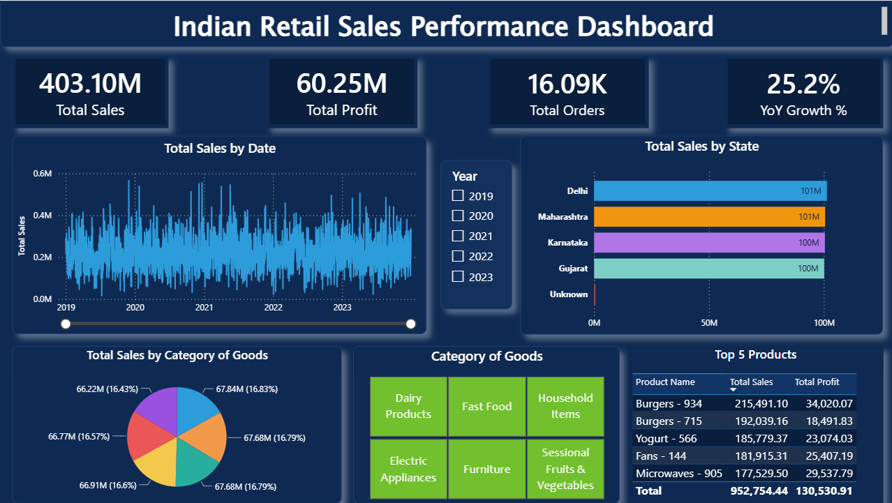

# 🇮🇳 Indian Retail Sales Performance Dashboard

An end-to-end Power BI project analyzing retail sales performance across Indian states, product categories, and time — built with a star schema data model, custom DAX measures, and interactive visuals to support business decision-making.

## 📌 Problem Statement

Assume you're a BI Analyst for a retail chain operating across multiple Indian states. Leadership wants visibility into:
- Which states and product categories are driving revenue and profit
- How sales are trending over time, and year-over-year growth
- Where discounting is eating into profitability
- Data quality issues in the raw sales data that need to be flagged before reporting

This dashboard answers those questions end-to-end — from raw, messy data to a decision-ready report.

## 🗂️ Dataset

- Source: Kaggle (Indian retail sales data), filtered to 2022–2023 and 4 major states (Maharashtra, Karnataka, Delhi, Gujarat) — ~16,000 transaction records
- Columns include customer details, product details, order/ship dates, sales, discount, profit, and region info
- The raw dataset was intentionally seeded with realistic data-quality issues (duplicates, missing values, inconsistent casing, inconsistent date formats, negative profit values) to simulate real-world messy data and demonstrate the cleaning process

## 🧹 Data Cleaning (Power Query)

- Removed duplicate transaction records
- Handled missing `State` values by flagging them as `"Unknown"` instead of dropping rows (preserves data, avoids silent data loss)
- Standardized inconsistent text casing in the `Segment` column (e.g., "CORPORATE", "consumer" → "Corporate", "Consumer")
- Converted inconsistently formatted date columns (Order Date, Ship Date, Sales Date, Date of Birth) into proper Date types
- Identified and flagged negative-profit transactions with a `Loss Flag` calculated column — treated as a genuine business insight (loss-making sales) rather than an error to be deleted
- Removed the `Region` field from the location dimension after finding it inconsistently mapped to `State` in the raw data (a real data-quality issue), keeping only reliable fields in the dimension table

## ⭐ Data Model — Star Schema

The flat raw dataset (25 columns) was restructured into a proper star schema for clean, scalable DAX:

- **Fact_Sales** (`indian_retail_sales_raw`) — transactional data: Order ID, Sales, Profit, Quantity, Discount, dates
- **Dim_Customer** — Customer ID, Name, Date of Birth, Segment
- **Dim_Product** — Product ID, Category, Sub-Category, Product Name
- **Dim_Location** — State, Country
- **Dim_Date** — Calendar table (built with DAX) with Year, Quarter, Month, Weekday

All dimension tables are connected to the fact table via one-to-many relationships.

## 🧮 Key DAX Measures

```dax
Total Sales = SUM(indian_retail_sales_raw[Sales])
Total Profit = SUM(indian_retail_sales_raw[Profit])
Total Orders = DISTINCTCOUNT(indian_retail_sales_raw[Order ID])
Avg Order Value = DIVIDE([Total Sales], [Total Orders])
Loss % = DIVIDE(CALCULATE(COUNTROWS(indian_retail_sales_raw), indian_retail_sales_raw[Profit] < 0), COUNTROWS(indian_retail_sales_raw))
Sales LY = CALCULATE([Total Sales], SAMEPERIODLASTYEAR(Dim_Date[Date]))
YoY Growth % = DIVIDE([Total Sales] - [Sales LY], [Sales LY])
Discount Impact = SUMX(indian_retail_sales_raw, indian_retail_sales_raw[Discount] * indian_retail_sales_raw[Sales])
```

## 📊 Dashboard Features

- **KPI Cards** — Total Sales, Total Profit, Total Orders, YoY Growth %
- **Sales Trend** — daily sales trend line (2019–2023) with a Year range slicer
- **Sales by State** — bar chart comparing performance across Delhi, Maharashtra, Karnataka, and Gujarat
- **Sales by Category** — donut chart showing revenue share across 6 product categories
- **Top 5 Products** — table ranked by Total Sales, with Total Profit
- **Interactive slicers** — filter by Year and Product Category
- Custom dark theme for a clean, professional look

## 💡 Key Insights

- Total Sales of ₹403.10M across ~16,000 orders, with ₹60.25M in total profit
- 25.2% YoY sales growth
- Sales are fairly evenly distributed across all 4 states (~100–101M each) — no single state dominates
- Product category revenue is nearly balanced (~16–17% share each across 6 categories)
- Burgers, Yogurt, Fans, and Microwaves lead the Top 5 products by sales
- A small but measurable share of transactions are loss-making, tracked via the `Loss %` measure — a candidate for further discount-policy review

## 🛠️ Tools Used

Power BI (Power Query, Data Modeling, DAX) · Excel (data pre-processing) · Kaggle dataset

## 📷 Dashboard Preview



## 📁 Files

- `Indian_Retail_Sales_Dashboard.pbix` — full Power BI report
- `indian_retail_sales_raw.csv` — raw dataset (with intentional data-quality issues, as cleaned in Power Query)
- `screenshots/` — dashboard preview

---
**Author:** Anoop Chaudhary — [LinkedIn](https://www.linkedin.com/in/anoop-ch168)
